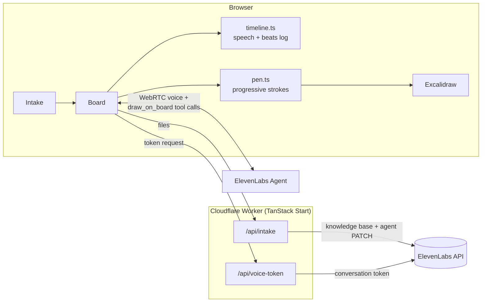

# Sketch

**A voice tutor that teaches on a shared whiteboard.**

Bring your course material, talk through what you don't understand, and work it out together on the board. Arabic by default, fully right-to-left.

[](https://github.com/husamql3/sketch/actions/workflows/ci.yml)
[](LICENSE)
[](https://hacktoberfest.com)

> **Status: prototype.** Built at Hacktoberfest Hack Day Istanbul x Hadith Tech 2026. See [PROTOTYPE.md](PROTOTYPE.md) for the question it answers and its known gaps.

<!-- Demo: replace with a GIF or video of a real session -->
<!--  -->

## Why

Text chatbots explain by writing paragraphs. Human tutors explain by talking and sketching at the same time, and students interrupt them constantly. Sketch tries to get that feel: the tutor speaks and draws in sync, and when you cut in, voice and pen stop together and the answer is drawn somewhere new, so the original figure stays intact to return to.

## Features

- **Learns from your material.** Drop a PDF, TXT, or MD file. It goes into the voice agent's knowledge base before the call starts, and the tutor opens with a summary of it.
- **Live voice call** over WebRTC with an ElevenLabs agent. Speaks Modern Standard Arabic by default and switches to the student's language.
- **Progressive drawing.** The tutor calls a `draw_on_board` tool with text, arrows, lines, boxes, and ellipses. Marks are validated with Zod and drawn at marker speed on an Excalidraw board.
- **Real interruptions.** Speaking or typing mid-explanation stops the voice and the pen mid-stroke. The beat is marked `cut`, and the answer goes into a new figure.
- **Lesson timeline.** A side panel shows what was said and drawn, in order, including cuts and interruptions.
- **API key stays on the server.** The browser only gets a short-lived conversation token.

## How it works

1. Drop a file and optionally type your question.
2. The board opens and a live voice call starts.
3. The tutor summarizes the material, then explains step by step while drawing.
4. Cut in any time by talking or typing.



| Path | Role |
| --- | --- |
| `src/tutor/timeline.ts` | Pure reducer: one ordered log for speech, drawing beats, and interruptions. A cut beat can never progress. |
| `src/tutor/pen.ts` | Draws one mark at a time like a pen and stops when the abort signal fires. |
| `src/tutor/elements.ts` | Zod schema for the marks the agent may draw. |
| `src/tutor/Board.tsx` | The call: ElevenLabs conversation, `draw_on_board` client tool, timeline panel, composer. |
| `src/tutor/Intake.tsx` | Opening screen: file drop and first question. |
| `src/routes/api/` | Server routes for file intake and the voice token. |
| `scripts/create-agent.ts` | One-time setup of the ElevenLabs agent's prompt and tool. |

## Tech stack

- [TanStack Start](https://tanstack.com/start) + React 19, deployed on [Cloudflare Workers](https://workers.cloudflare.com)
- [ElevenLabs Agents](https://elevenlabs.io/docs/eleven-agents) for realtime voice (WebRTC) and the knowledge base
- [Excalidraw](https://excalidraw.com) for the board
- Tailwind CSS v4, Zod, TypeScript, Vite, Bun

## Getting started

### Prerequisites

- [Bun](https://bun.sh)
- An [ElevenLabs](https://elevenlabs.io) account and API key with access to Agents
- Chrome (or another browser with WebRTC and microphone access)

### Quick start

```sh
git clone https://github.com/husamql3/sketch.git
cd sketch
bun install
cp .dev.vars.example .dev.vars   # add ELEVENLABS_API_KEY
bun run agent                    # sets up the tutor agent, writes ELEVENLABS_AGENT_ID
bun dev                          # http://localhost:3000
```

Open http://localhost:3000 and allow the microphone.

### Environment variables

Local secrets live in `.dev.vars` (the Cloudflare Workers convention), which is git-ignored.

| Variable | Required | Description |
| --- | --- | --- |
| `ELEVENLABS_API_KEY` | Yes | ElevenLabs API key. Used only on the server. |
| `ELEVENLABS_AGENT_ID` | Yes | The tutor agent. Written by `bun run agent` if empty. If set, `bun run agent` updates that agent instead and backs up its old config to `.agent-backup.json`. |

For a deployed Worker, set them as secrets with `bunx wrangler secret put ELEVENLABS_API_KEY` (and the same for `ELEVENLABS_AGENT_ID`).

### Scripts

| Command | What it does |
| --- | --- |
| `bun dev` | Dev server on port 3000 |
| `bun run build` | Production build |
| `bun run preview` | Preview the production build |
| `bun run typecheck` | `tsc --noEmit` |
| `bun run agent` | Create or update the ElevenLabs tutor agent |
| `bun run deploy` | Build and deploy to Cloudflare Workers |

## Usage

1. Drop a lecture PDF and type "velocity-time graphs" (or leave it blank and say it).
2. The tutor gives a short summary and starts drawing axes while talking.
3. While it draws, say "wait, why is the slope acceleration?"
4. The voice stops, the pen stops mid-stroke, the beat is marked `cut`, and the answer is drawn in a new figure to the right.
5. Say "ok, continue". It goes back to the original figure by name.

<!-- Screenshots: add images of the intake screen and the board here -->

## Roadmap

These come from the prototype's known gaps and open questions in [PROTOTYPE.md](PROTOTYPE.md):

- [ ] One agent (or knowledge base) per session, so parallel sessions don't overwrite each other's material
- [ ] Rate limiting or auth on the `/api` routes before public deployment
- [ ] Session persistence, so a reload doesn't lose the lesson
- [ ] Let the agent see what the student draws
- [ ] Try a non-blocking `draw_on_board` with a queue, if blocking pauses feel unnatural
- [ ] Unit tests for the `timeline.ts` reducer
- [ ] Swap the composer for shadcn AI Elements `PromptInput`

## Contributing

Contributions are welcome, including during Hacktoberfest. Read [CONTRIBUTING.md](CONTRIBUTING.md) for setup, branch workflow, and the PR process, and follow the [Code of Conduct](CODE_OF_CONDUCT.md). Found a vulnerability? See [SECURITY.md](SECURITY.md).

## Team

Built at **Hacktoberfest Hack Day Istanbul x Hadith Tech 2026** by the people in [CONTRIBUTORS.md](CONTRIBUTORS.md).

## License

[MIT](LICENSE)
